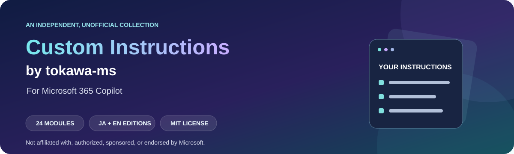

<p align="center">
  
</p>

<h1 align="center">Custom Instructions by tokawa-ms</h1>

<p align="center">An unofficial instruction collection for Microsoft 365 Copilot</p>

<p align="center">
  Research, write, compare, and communicate.<br>
  Pick from 21 instruction modules to fit the way you work.
</p>

<p align="center">
  <a href="LICENSE"></a>
  <a href="#-instruction-catalog"></a>
  <a href="readme.md"></a>
  
</p>

<p align="center">
  <a href="readme.md">日本語</a> · <strong>English</strong><br>
  <a href="#-quick-start">Quick start</a> ·
  <a href="#-instruction-catalog">Catalog</a> ·
  <a href="#-suggested-combinations">Combinations</a> ·
  <a href="CONTRIBUTING.md#english">Contributing</a>
</p>

---

A collection of custom instructions for tailoring Microsoft 365 Copilot responses to your workflow. Choose only the modules you need, copy them, and make them your own. The Japanese and English editions cover the same 21 topics in separate language directories.

| 🧩 Pick what you need                                                    | 📋 Ready to copy                                                        | 🌐 Share in two languages                                                        |
| ------------------------------------------------------------------------ | ----------------------------------------------------------------------- | -------------------------------------------------------------------------------- |
| Every module stands on its own. No need to install the whole collection. | Instructions are separate from explanations, with copyable code blocks. | Choose the Japanese or English version of each topic and adapt it for your team. |

> [!NOTE]
> This is an independent collection published by tokawa-ms in a personal capacity, not an official Microsoft publication. The collection is not affiliated with, authorized, sponsored, or endorsed by Microsoft Corporation and does not represent Microsoft's views.
>
> The custom instructions in this repository were written with assistance from generative AI.
>
> It is intended for **Microsoft 365 Copilot** custom instructions, not GitHub Copilot's `copilot-instructions.md`. Cloning this repository does not automatically apply any instructions.

## 🚀 Quick start

1. Choose a [recommended role set](#recommended-role-sets) or a topic from the [instruction catalog](#-instruction-catalog) and open its English or Japanese version.
2. Copy the contents of the code block under “Instructions to copy” or “コピー用の指示”.
3. Paste them into the custom instructions setting in your Microsoft 365 Copilot environment, edit as needed, and save.
4. Try a typical request. If responses become too long or ask unnecessary questions, shorten or remove the relevant module.

To combine modules, join their contents, including their headings, with blank lines. Do not paste the surrounding explanations or code-fence markers. You do not need both language versions of the same module.

To copy all 21 modules at once, use the **[English combined edition](instructions/en/00-all/README.md)** or the **[Japanese combined edition](instructions/ja/00-all/README.md)**. Each `00-all` directory includes a README with one copyable block and a `custom-instructions.md` file containing only the instructions. Do not paste both the combined edition and its individual modules.

> [!TIP]
> Start with **01 Responsible AI + 07 Uncertainty + 09 Language**. For task-specific guidance such as detailed design documents, you can include a module in the individual prompt instead of keeping it in your standing instructions.

Check feature availability, settings, input limits, and scope in your own environment. If the instructions do not fit, select fewer modules. Asking for search or external references does not enable unavailable features or grant access.

## 🧩 Instruction catalog

Numbers organize the collection; they do not set execution order or priority. Each page includes a use case, a copyable instruction block, and customization notes.

| #   | Module                                            | Use it to…                                                                    |                            日本語                            |                           English                            |
| --- | ------------------------------------------------- | ----------------------------------------------------------------------------- | :----------------------------------------------------------: | :----------------------------------------------------------: |
| 00  | All instructions                                  | Copy modules 01–21 in one step                                                |           [開く](instructions/ja/00-all/README.md)           |           [Open](instructions/en/00-all/README.md)           |
| 01  | Responsible AI                                    | Consider safety, privacy, and fairness                                        |     [開く](instructions/ja/01-responsible-ai/README.md)      |     [Open](instructions/en/01-responsible-ai/README.md)      |
| 02  | Research                                          | Prioritize primary sources and cover key questions                            |        [開く](instructions/ja/02-research/README.md)         |        [Open](instructions/en/02-research/README.md)         |
| 03  | Conflicting sources                               | Explain disagreements between sources                                         |   [開く](instructions/ja/03-conflicting-sources/README.md)   |   [Open](instructions/en/03-conflicting-sources/README.md)   |
| 04  | Entity verification                               | Avoid confusing identical or similar names                                    |   [開く](instructions/ja/04-entity-verification/README.md)   |   [Open](instructions/en/04-entity-verification/README.md)   |
| 05  | Quantitative data                                 | Clarify subjects, periods, units, and assumptions                             |    [開く](instructions/ja/05-quantitative-data/README.md)    |    [Open](instructions/en/05-quantitative-data/README.md)    |
| 06  | Ambiguity                                         | Reduce unnecessary questions and risky assumptions                            |        [開く](instructions/ja/06-ambiguity/README.md)        |        [Open](instructions/en/06-ambiguity/README.md)        |
| 07  | Uncertainty                                       | Separate facts, inferences, proposals, and unknowns                           |       [開く](instructions/ja/07-uncertainty/README.md)       |       [Open](instructions/en/07-uncertainty/README.md)       |
| 08  | High-risk contexts                                | Handle consequential assumptions and claims carefully                         |        [開く](instructions/ja/08-high-risk/README.md)        |        [Open](instructions/en/08-high-risk/README.md)        |
| 09  | Language                                          | Control the default response language                                         |        [開く](instructions/ja/09-language/README.md)         |        [Open](instructions/en/09-language/README.md)         |
| 10  | Technical documentation                           | Write concrete documentation that covers exceptions                           | [開く](instructions/ja/10-technical-documentation/README.md) | [Open](instructions/en/10-technical-documentation/README.md) |
| 11  | Detailed design                                   | Standardize design structure and track open decisions                         |     [開く](instructions/ja/11-detailed-design/README.md)     |     [Open](instructions/en/11-detailed-design/README.md)     |
| 12  | Market analysis                                   | Make evidence-based comparisons and analyses                                  |     [開く](instructions/ja/12-market-analysis/README.md)     |     [Open](instructions/en/12-market-analysis/README.md)     |
| 13  | Synthetic data                                    | Create realistic demo data without presenting it as real                      |     [開く](instructions/ja/13-synthetic-data/README.md)      |     [Open](instructions/en/13-synthetic-data/README.md)      |
| 14  | Audience-first documents                          | Build materials around audience needs and actions                             |     [開く](instructions/ja/14-audience-first/README.md)      |     [Open](instructions/en/14-audience-first/README.md)      |
| 15  | Instruction priority                              | Resolve conflicts between selected instructions                               |  [開く](instructions/ja/15-instruction-priority/README.md)   |  [Open](instructions/en/15-instruction-priority/README.md)   |
| 16  | Work context and decision history                 | Use internal agreements and constraints alongside external evidence           |      [開く](instructions/ja/16-work-context/README.md)       |      [Open](instructions/en/16-work-context/README.md)       |
| 17  | Engineering: design decisions and validation      | Make testable technical proposals grounded in existing designs                |  [開く](instructions/ja/17-engineering-decisions/README.md)  |  [Open](instructions/en/17-engineering-decisions/README.md)  |
| 18  | Marketing: customer insight and experiment design | Turn customer evidence into messaging and measurable campaigns                |   [開く](instructions/ja/18-marketing-evidence/README.md)    |   [Open](instructions/en/18-marketing-evidence/README.md)    |
| 19  | Sales: opportunity evidence and next agreements   | Separate customer facts from internal expectations and define next agreements |   [開く](instructions/ja/19-sales-qualification/README.md)   |   [Open](instructions/en/19-sales-qualification/README.md)   |
| 20  | Management: team execution and support            | Support delivery through outcomes, dependencies, and capacity                 |  [開く](instructions/ja/20-management-execution/README.md)   |  [Open](instructions/en/20-management-execution/README.md)   |
| 21  | Executives: strategy and resource allocation      | Compare strategic options, investment allocation, and decision criteria       |   [開く](instructions/ja/21-executive-strategy/README.md)    |   [Open](instructions/en/21-executive-strategy/README.md)    |

Module 09 has locale-specific defaults. The Japanese edition defaults summaries to Japanese, while the English edition responds in the language used by the user unless a response language is explicitly specified.

## ✨ Suggested combinations

| Your task                                          | Modules to choose                                                                                                         |
| -------------------------------------------------- | ------------------------------------------------------------------------------------------------------------------------- |
| ☀️ Everyday responses and summaries                | **01** Responsible AI + **07** Uncertainty + **09** Language                                                              |
| 🔎 Research and comparison                         | **02** Research + **03** Conflicting sources + **04** Entity verification + **05** Quantitative data + **07** Uncertainty |
| 🛠️ Technical and design documents                  | **07** Uncertainty + **10** Technical documentation + **11** Detailed design                                              |
| 📊 Market and competitive analysis                 | **02** Research + **05** Quantitative data + **12** Market analysis                                                       |
| 🎬 Demos and presentations                         | **13** Synthetic data + **14** Audience-first documents                                                                   |
| Engineering proposals                              | **16** Work context + **17** Design decisions and validation                                                              |
| Marketing campaign planning                        | **16** Work context + **18** Customer insight and experiment design                                                       |
| Sales meeting preparation and opportunity analysis | **16** Work context + **19** Opportunity evidence and next agreements                                                     |
| Team management                                    | **16** Work context + **20** Team execution and support                                                                   |
| Executive strategy and investment decisions        | **16** Work context + **21** Strategy and resource allocation                                                             |

When assembling the combinations above from individual modules, add 08 for high-risk contexts and 15 to make priorities explicit. The role sets below already include both. Omitting 01 or 15 does not remove product safety constraints or organizational policies.

### Recommended role sets

These sets provide consistent handling of evidence and uncertainty across roles. Copy the single code block on a set's page to start using it. Every set includes **13 shared modules: 01-09 + 12 Market analysis + 14 Audience-first + 15 Instruction priority + 16 Work context**. Shared application guidance comes first, followed by the complete source instructions in numerical order, including the role-specific additions below.

| Role       | Modules added to the base set                                           | 日本語                                                 | English                                              |
| ---------- | ----------------------------------------------------------------------- | ------------------------------------------------------ | ---------------------------------------------------- |
| Engineers  | **10** Technical documentation + **17** Design decisions and validation | [コピー用セット](instructions/ja/presets/engineer.md)  | [Copyable set](instructions/en/presets/engineer.md)  |
| Marketing  | **18** Customer insight and experiment design                           | [コピー用セット](instructions/ja/presets/marketing.md) | [Copyable set](instructions/en/presets/marketing.md) |
| Sales      | **19** Opportunity evidence and next agreements                         | [コピー用セット](instructions/ja/presets/sales.md)     | [Copyable set](instructions/en/presets/sales.md)     |
| Managers   | **20** Team execution and support                                       | [コピー用セット](instructions/ja/presets/manager.md)   | [Copyable set](instructions/en/presets/manager.md)   |
| Executives | **21** Strategy and resource allocation                                 | [コピー用セット](instructions/ja/presets/executive.md) | [Copyable set](instructions/en/presets/executive.md) |

Start with one set; do not also paste the all-instructions edition or included individual modules. Remove whole modules if needed to fit your input limit. In English sets, module 09 follows the language of the user's request unless a response language is explicitly specified.

Standing guidance does not mean executing every step on every request. Research and cross-check when factual verification is needed; apply high-risk checks, market analysis, audience-first structure, and internal searches when relevant. Do not add unnecessary searches, clarification questions, analytical frameworks, introductions, or next steps to simple formatting, translation, or short factual requests. The aim is rigor through necessary verification and clear distinctions between facts, inference, and unknowns, not longer answers.

Modules 17 through 21 are role-specific. Select relevant roles rather than keeping all five in standing instructions, and specify the account or project, period, and reference materials in each request. Add 11 Detailed design and 13 Synthetic data to individual requests when needed. Management guidance focuses on team execution; executive guidance focuses on enterprise or business choices and resource allocation.

These modules guide the use of available work information through capabilities such as Work IQ, alongside external primary sources appropriate to the question. Instructions alone do not add internal search or connections to a CRM, source code, or analytics systems. Treat inaccessible information as unverified.

Custom instructions are the policy layer of a harness, not an enforcement mechanism that guarantees searches run, citations are correct, or instructions are followed. Quality improvements are not guaranteed. Compare responses with and without the instructions, or before and after changes, using the same materials and request. Check evidence accuracy, missed constraints, unknowns presented as facts, actionable next steps when needed, and response length, then adjust. Use cases such as same-name companies, differently defined figures, conflicting sources, unavailable search, and simple text formatting to check both unsupported assertions and unnecessary searches or clarification questions.

## 📁 Repository layout

```text
.
├── readme.md                 # Japanese guide
├── readme-en.md              # English guide
├── LICENSE                   # MIT / tokawa-ms
├── CONTRIBUTING.md           # Bilingual contribution guide
├── assets/
│   └── banner.svg
├── scripts/
│   └── Update-AllInstructions.ps1
└── instructions/
    ├── ja/
    │   ├── 00-all/
    │   │   ├── README.md
    │   │   └── custom-instructions.md
    │   ├── 01-responsible-ai/README.md
    │   ├── ...
    │   └── 21-executive-strategy/README.md
    └── en/
        ├── 00-all/
        │   ├── README.md
        │   └── custom-instructions.md
        ├── 01-responsible-ai/README.md
        ├── ...
        └── 21-executive-strategy/README.md
```

## 🛡️ Usage notes

- Custom instructions express preferences. They do not replace access controls, information protection, or compliance mechanisms, and do not guarantee accuracy or adherence.
- Do not include nonpublic customer names, personal data, credentials, internal URLs, contract terms, or internal settings in documents, issues, pull requests, or response examples.
- Check consequential numbers, specifications, and quotations against their original sources. Do not make high-risk decisions solely on an AI response.
- When sharing synthetic data, include enough context to prevent it from being mistaken for real data outside the original conversation.

## 🤝 Contributing

Wording improvements, translation corrections, and use-case suggestions are welcome. Follow [CONTRIBUTING.md](CONTRIBUTING.md#english), keep each instruction block independently usable, and maintain equivalent content across both languages.

## 📄 License

[MIT License](LICENSE) · Copyright (c) 2026 **tokawa-ms**

You may copy, modify, and redistribute this collection under the MIT License. Include the copyright and permission notices in copies or substantial portions, as required by the license. The collection is provided without warranty.

Microsoft, Microsoft 365, and Microsoft 365 Copilot are trademarks of the Microsoft group of companies. All other trademarks are the property of their respective owners. Product names identify the products this collection is intended for; this repository's MIT License does not grant rights to third-party trademarks.
