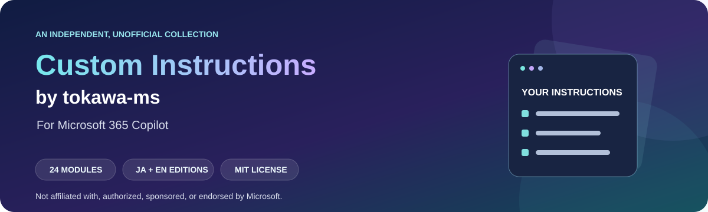

<p align="center">
  
</p>

<h1 align="center">Custom Instructions by tokawa-ms</h1>

<p align="center">Microsoft 365 Copilot 向けの非公式指示集</p>

<p align="center">
  調べる、書く、比較する、伝える。<br>
  いつもの仕事に合わせて選べる、21のカスタム指示。
</p>

<p align="center">
  <a href="LICENSE"></a>
  <a href="#-指示カタログ"></a>
  <a href="readme-en.md"></a>
  
</p>

<p align="center">
  <strong>日本語</strong> · <a href="readme-en.md">English</a><br>
  <a href="#-クイックスタート">使い方</a> ·
  <a href="#-指示カタログ">指示カタログ</a> ·
  <a href="#-おすすめの組み合わせ">組み合わせ</a> ·
  <a href="CONTRIBUTING.md">コントリビュート</a>
</p>

---

Microsoft 365 Copilot の回答を、自分の仕事の進め方に合わせるための指示集です。必要な項目だけを選び、コピーして、自分向けに調整できます。日本語版と英語版は同じ21項目を収録し、言語ごとにディレクトリを分けています。

| 🧩 必要な項目だけ                                      | 📋 コピーしやすい                                            | 🌐 日英で共有                                                |
| ------------------------------------------------------ | ------------------------------------------------------------ | ------------------------------------------------------------ |
| 各項目は単独で利用可能。全部を入れる必要はありません。 | 説明と指示を分離。コードブロックのボタンからコピーできます。 | 同じ項目の日本語・英語を選択。チームに合わせて編集できます。 |

> [!NOTE]
> 本指示集は tokawa-ms が個人として公開する独立した資料であり、Microsoft の公式資料ではありません。Microsoft による承認・推奨・スポンサー提供を受けたものではなく、同社の見解を代表しません。
>
> 本リポジトリのカスタム指示は、生成 AI の支援を受けて作成しています。
>
> 対象は **Microsoft 365 Copilot** のカスタム指示です。GitHub Copilot 用の `copilot-instructions.md` ではなく、このリポジトリを置くだけで自動適用されるものでもありません。

## 🚀 クイックスタート

1. [職種別おすすめセット](#職種別おすすめセット)または[指示カタログ](#-指示カタログ)から、使いたい日本語版または英語版を開きます。
2. 「コピー用の指示」または「Instructions to copy」にあるコードブロックの中身をコピーします。
3. 利用中の Microsoft 365 Copilot のカスタム指示の設定欄に貼り付け、必要に応じて編集して保存します。
4. 普段の依頼で試し、長すぎる回答や不要な確認が増えたら、指示を短くするか対象項目を外します。

複数の項目を使う場合は、見出しを含めた本文を空行で区切って連結します。説明文やコードブロックの囲み記号は貼り付けません。同じ項目の日英両方を入れる必要はありません。

全21項目をまとめて使いたい場合は、**[日本語の一括版](instructions/ja/00-all/README.md)** または **[英語の一括版](instructions/en/00-all/README.md)** を利用できます。各`00-all`フォルダには、一括コピー用のREADMEと、指示本文だけの`custom-instructions.md`を配置しています。一括版と個別項目を重複して貼り付ける必要はありません。

> [!TIP]
> 最初は **01 責任ある応答 + 07 不確実性 + 09 言語** から。詳細設計書など、その作業だけに必要な指示は、常設せず依頼文に添える方法もあります。

カスタム指示の提供状況、設定画面、入力上限、適用範囲は利用環境で確認してください。入りきらない場合は、必要な項目に絞ってください。検索や外部参照を求めても、利用できない機能やアクセス権は追加されません。

## 🧩 指示カタログ

番号は整理用であり、適用順や優先順位を表しません。各ページには用途、コピー用の本文、調整のポイントがあります。

| #   | 項目                               | こんなときに                                       |                            日本語                            |                           English                            |
| --- | ---------------------------------- | -------------------------------------------------- | :----------------------------------------------------------: | :----------------------------------------------------------: |
| 00  | 全項目の一括版                     | 01〜21の指示をまとめてコピーしたい                 |           [開く](instructions/ja/00-all/README.md)           |           [Open](instructions/en/00-all/README.md)           |
| 01  | 責任ある応答                       | 安全性、プライバシー、公平性を踏まえたい           |     [開く](instructions/ja/01-responsible-ai/README.md)      |     [Open](instructions/en/01-responsible-ai/README.md)      |
| 02  | 調査の基本方針                     | 一次情報を重視し、主要な論点を確認したい           |        [開く](instructions/ja/02-research/README.md)         |        [Open](instructions/en/02-research/README.md)         |
| 03  | 情報源の矛盾                       | 資料同士の食い違いを整理したい                     |   [開く](instructions/ja/03-conflicting-sources/README.md)   |   [Open](instructions/en/03-conflicting-sources/README.md)   |
| 04  | 固有名詞の同定                     | 同名・類似名の対象を取り違えたくない               |   [開く](instructions/ja/04-entity-verification/README.md)   |   [Open](instructions/en/04-entity-verification/README.md)   |
| 05  | 定量データ                         | 数値の対象、期間、単位、前提を明らかにしたい       |    [開く](instructions/ja/05-quantitative-data/README.md)    |    [Open](instructions/en/05-quantitative-data/README.md)    |
| 06  | 曖昧な依頼への対応                 | 不要な確認と危険な思い込みを減らしたい             |        [開く](instructions/ja/06-ambiguity/README.md)        |        [Open](instructions/en/06-ambiguity/README.md)        |
| 07  | 不確実性の表現                     | 事実、推論、提案、未確認事項を区別したい           |       [開く](instructions/ja/07-uncertainty/README.md)       |       [Open](instructions/en/07-uncertainty/README.md)       |
| 08  | 高リスク領域                       | 影響の大きい相談で、前提や断定を慎重に扱いたい     |        [開く](instructions/ja/08-high-risk/README.md)        |        [Open](instructions/en/08-high-risk/README.md)        |
| 09  | 言語                               | 回答言語の既定動作を指定したい                     |        [開く](instructions/ja/09-language/README.md)         |        [Open](instructions/en/09-language/README.md)         |
| 10  | 技術文書                           | 具体的で、例外条件も考慮した文書を作りたい         | [開く](instructions/ja/10-technical-documentation/README.md) | [Open](instructions/en/10-technical-documentation/README.md) |
| 11  | 詳細設計書                         | 構成と未決事項の扱いを揃えたい                     |     [開く](instructions/ja/11-detailed-design/README.md)     |     [Open](instructions/en/11-detailed-design/README.md)     |
| 12  | 市場・企業・製品分析               | 根拠のある比較と分析をしたい                       |     [開く](instructions/ja/12-market-analysis/README.md)     |     [Open](instructions/en/12-market-analysis/README.md)     |
| 13  | デモ・合成データ                   | 自然なサンプルを実データと混同せず作りたい         |     [開く](instructions/ja/13-synthetic-data/README.md)      |     [Open](instructions/en/13-synthetic-data/README.md)      |
| 14  | 読み手・聴衆中心の資料             | 相手の課題と行動を中心に資料を作りたい             |     [開く](instructions/ja/14-audience-first/README.md)      |     [Open](instructions/en/14-audience-first/README.md)      |
| 15  | 指示の競合                         | 複数の指示の優先関係を明示したい                   |  [開く](instructions/ja/15-instruction-priority/README.md)   |  [Open](instructions/en/15-instruction-priority/README.md)   |
| 16  | 社内文脈と決定履歴                 | 社内の合意・制約と外部情報を使い分けたい           |      [開く](instructions/ja/16-work-context/README.md)       |      [Open](instructions/en/16-work-context/README.md)       |
| 17  | エンジニア：設計判断と検証         | 既存設計を踏まえ、検証可能な技術提案をしたい       |  [開く](instructions/ja/17-engineering-decisions/README.md)  |  [Open](instructions/en/17-engineering-decisions/README.md)  |
| 18  | マーケティング：顧客理解と施策検証 | 顧客の声から訴求と測定可能な施策を作りたい         |   [開く](instructions/ja/18-marketing-evidence/README.md)    |   [Open](instructions/en/18-marketing-evidence/README.md)    |
| 19  | 営業：案件の根拠と次の合意         | 顧客の事実と社内の期待を分け、次の合意を整理したい |   [開く](instructions/ja/19-sales-qualification/README.md)   |   [Open](instructions/en/19-sales-qualification/README.md)   |
| 20  | マネージャー：チームの実行と支援   | 成果・依存関係・余力からチームの実行を支援したい   |  [開く](instructions/ja/20-management-execution/README.md)   |  [Open](instructions/en/20-management-execution/README.md)   |
| 21  | 経営者：戦略と資源配分             | 戦略の代替案、投資配分、判断条件を整理したい       |   [開く](instructions/ja/21-executive-strategy/README.md)    |   [Open](instructions/en/21-executive-strategy/README.md)    |

09は言語版ごとに既定動作が異なります。日本語版は要約を日本語で返し、英語版は回答言語の明示的な指定がなければ、利用者が話しかけた言語で回答します。

## ✨ おすすめの組み合わせ

| やりたいこと                | 選ぶ項目                                                                                  |
| --------------------------- | ----------------------------------------------------------------------------------------- |
| ☀️ 日常の回答・要約         | **01** 責任ある応答 + **07** 不確実性 + **09** 言語                                       |
| 🔎 調査・比較               | **02** 調査 + **03** 情報源の矛盾 + **04** 固有名詞 + **05** 定量データ + **07** 不確実性 |
| 🛠️ 技術文書・設計書         | **07** 不確実性 + **10** 技術文書 + **11** 詳細設計書                                     |
| 📊 市場・競合分析           | **02** 調査 + **05** 定量データ + **12** 市場分析                                         |
| 🎬 デモ・プレゼンテーション | **13** 合成データ + **14** 読み手・聴衆中心の資料                                         |
| エンジニアの技術提案        | **16** 社内文脈 + **17** 設計判断と検証                                                   |
| マーケティングの施策立案    | **16** 社内文脈 + **18** 顧客理解と施策検証                                               |
| 営業の商談準備・案件分析    | **16** 社内文脈 + **19** 案件の根拠と次の合意                                             |
| マネージャーのチーム運営    | **16** 社内文脈 + **20** チームの実行と支援                                               |
| 経営者の戦略・投資判断      | **16** 社内文脈 + **21** 戦略と資源配分                                                   |

高リスクな相談には08を、複数の指示の優先関係を明示したい場合は15を追加できます。01や15を選ばなくても、製品の安全上の制約や組織のポリシーが解除されるわけではありません。

### 職種別おすすめセット

上の職種別2項目の最小構成に、基本方針と関連項目を加えたセットです。各ページのコードブロックを1回コピーするだけで使えます。全セット共通の基本項目は **01 責任ある応答 + 07 不確実性 + 09 言語 + 16 社内文脈** です。次の項目を加え、元の本文を省略せず収録しています。

| 職種           | 基本項目に加える指示                                            | 日本語                                                 | English                                              |
| -------------- | --------------------------------------------------------------- | ------------------------------------------------------ | ---------------------------------------------------- |
| エンジニア     | **10** 技術文書 + **17** 設計判断と検証                         | [コピー用セット](instructions/ja/presets/engineer.md)  | [Copyable set](instructions/en/presets/engineer.md)  |
| マーケティング | **12** 市場分析 + **14** 読み手中心 + **18** 顧客理解と施策検証 | [コピー用セット](instructions/ja/presets/marketing.md) | [Copyable set](instructions/en/presets/marketing.md) |
| 営業           | **14** 読み手中心 + **19** 案件の根拠と次の合意                 | [コピー用セット](instructions/ja/presets/sales.md)     | [Copyable set](instructions/en/presets/sales.md)     |
| マネージャー   | **08** 高リスク領域 + **20** チームの実行と支援                 | [コピー用セット](instructions/ja/presets/manager.md)   | [Copyable set](instructions/en/presets/manager.md)   |
| 経営者         | **05** 定量データ + **12** 市場分析 + **21** 戦略と資源配分     | [コピー用セット](instructions/ja/presets/executive.md) | [Copyable set](instructions/en/presets/executive.md) |

まずは1セットだけを選び、一括版や含まれる個別項目を重複して貼り付けないでください。入力上限に収まらない場合は項目単位で減らせます。英語版セットの09は、回答言語の明示的な指定がなければ利用者が話しかけた言語で回答します。

16は職種共通、17〜21は職種別の指示です。全職種分を常設せず、必要な職種を選び、案件名・対象期間・参照資料は個々の依頼で指定する使い方を推奨します。マネージャー向けはチームの実行、経営者向けは全社・事業の選択と資源配分に重点を置いています。

Work IQ などで利用可能な社内情報と外部の一次情報を、論点に応じて参照する方針です。指示だけで社内検索、CRM、ソースコード、分析基盤への接続が追加されるわけではありません。参照できない情報は未確認として扱います。

品質改善を保証するものではありません。同じ資料・依頼で指示あり／なしを比較し、根拠の正しさ、制約の見落とし、未確認事項の事実化、次の行動の具体性、回答の長さを確認して調整してください。

## 📁 ディレクトリ構成

```text
.
├── readme.md                 # 日本語のガイド
├── readme-en.md              # English guide
├── LICENSE                   # MIT / tokawa-ms
├── CONTRIBUTING.md           # 日英のコントリビューションガイド
├── assets/
│   └── banner.svg
├── scripts/
│   └── Update-AllInstructions.ps1
└── instructions/
    ├── ja/
    │   ├── 00-all/
    │   │   ├── README.md
    │   │   └── custom-instructions.md
    │   ├── 01-responsible-ai/README.md
    │   ├── ...
    │   └── 21-executive-strategy/README.md
    └── en/
        ├── 00-all/
        │   ├── README.md
        │   └── custom-instructions.md
        ├── 01-responsible-ai/README.md
        ├── ...
        └── 21-executive-strategy/README.md
```

## 🛡️ 利用上の注意

- カスタム指示は回答への希望を伝えるものです。アクセス制御、情報保護、法令遵守の仕組みを置き換えず、正確性や指示への準拠を保証しません。
- 非公開の顧客名、個人情報、認証情報、内部URL、契約条件、社内設定値を、本文・Issue・Pull Request・回答例に含めないでください。
- 重要な数値、仕様、引用は原典で確認し、高リスクな判断をAIの回答だけで行わないでください。
- 合成データを外部へ渡すときは、会話の文脈から切り離されても実データと誤認されない説明を添えてください。

## 🤝 コントリビュート

文言の改善、翻訳の修正、用途の提案を歓迎します。[CONTRIBUTING.md](CONTRIBUTING.md) に沿って、コピー用の本文を単独で使える形に保ち、日英の内容を揃えてください。

## 📄 ライセンス

[MIT License](LICENSE) · Copyright (c) 2026 **tokawa-ms**

コピー・改変・再配布が可能です。コピーまたは重要な部分の再利用には、MITライセンスに従って著作権表示と許諾表示を含めてください。本指示集は無保証で提供されます。

Microsoft、Microsoft 365、Microsoft 365 Copilot は Microsoft グループの企業の商標です。その他の商標は各権利者に帰属します。製品名は対象製品を示すために使用しており、本リポジトリの MIT ライセンスは第三者の商標の使用権を付与するものではありません。
